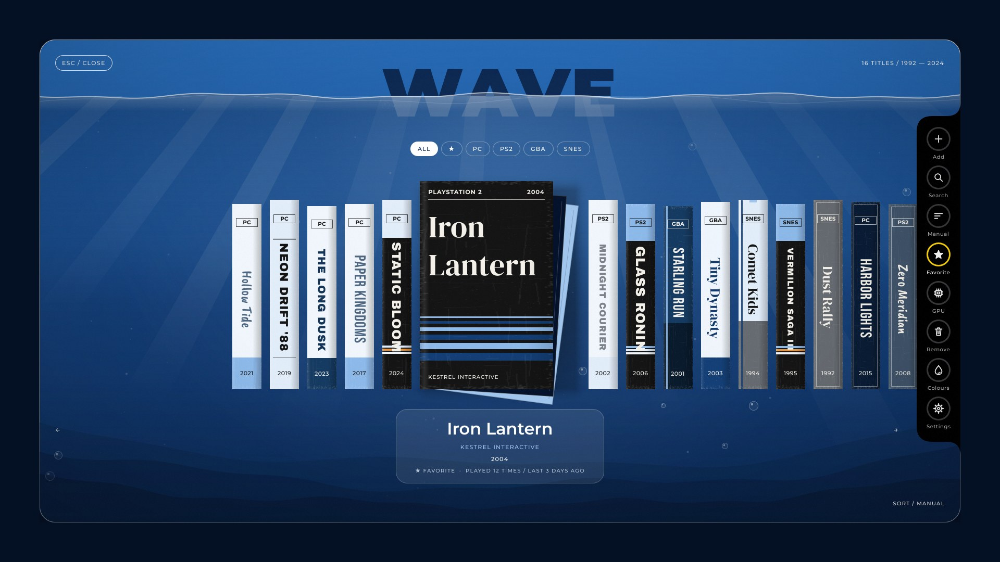
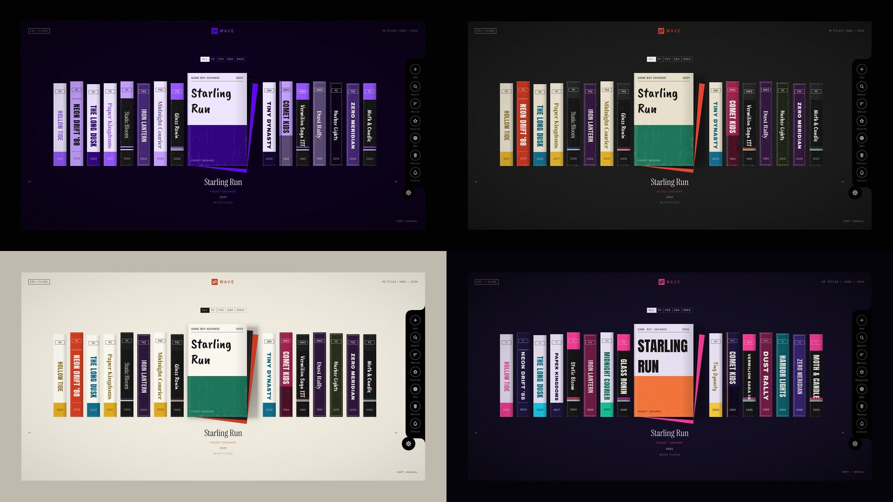

# Wave

A game launcher that looks like a shelf of rental tapes. Every game is a box
on the shelf; the selected one slides out to show its cover. Built with
[Quickshell](https://quickshell.org) for Hyprland and other wlroots compositors.



- **Draws its own artwork.** Games without a cover get a generated spine and
  sleeve (layout, typeface and colour are picked from the title), so the shelf
  looks finished before you collect a single image.
- **Your artwork when you have it.** Cover images, and optional spine images.
- **A side panel** with every action one click away: add, search, sort,
  favorite, dedicated GPU, remove, colours and settings.
- **Colour picker.** Choose an accent and a background and Wave works out the
  rest. Seven full themes are included too.
- **Steam aware.** Installed Steam games show up in the add screen with their
  cover art.
- **Add games from inside the launcher.** Pick an installed app, type a
  command, or browse to a file.
- **Groups, search, sorting, favorites, play history.**
- **Keyboard first**, with full mouse support.
- **Live reload.** Edit your games, config or theme and the shelf updates.



## Install

One line, no setup:

```sh
curl -fsSL https://raw.githubusercontent.com/pheenikks/wave/main/get.sh | sh
```

Then press **SUPER+G**. That is all: the shelf opens empty with an *Add a
game* button.

The installer needs no root. It downloads Wave to `~/.local/share/wave`, adds
a `wave` command and a **Wave** entry (with its icon) to your app launcher, adds one line to your `hyprland.conf` (autostart and the
SUPER+G keybind), and starts Wave. If [Quickshell](https://quickshell.org)
(0.2 or newer) is missing it prints the one command that installs it on your
distro. Wave targets Hyprland for now.

- **Update:** `wave update`
- **Different key:** edit `~/.config/wave/hyprland.conf`
- **Uninstall:** `wave uninstall` (your games and settings are kept)
- **Layer rules:** Wave's layer namespace is `wave`

<details>
<summary>Manual install</summary>

```sh
git clone https://github.com/pheenikks/wave ~/.local/share/wave
~/.local/share/wave/install.sh          # --no-hyprland to leave your config alone
```
</details>

## Putting games on the shelf

The shelf starts empty and only ever shows what you add.

**In Wave:** click **Add** in the side panel (or press `N`), then either

- type an app's name and pick it from your installed applications (its icon
  comes along), or
- type any command and choose *Run "..."*, or
- choose *Browse for a game file* and pick an executable, script, AppImage,
  `.exe` (runs with Wine) or ROM (opens with your default app for that type).

Check the title, command and optional group, press Enter, and the tape is on
the shelf. `Delete` twice takes the selected game off again.

### Steam games

Open the add screen and type the game's name. Every installed Steam game is
listed (tagged *Steam*) with its cover from Steam's own library; pick it and
press Enter twice. Wave launches it with `steam steam://rungameid/<id>`.
`wave steam` prints the same list in a terminal, and `wave add --steam <id>`
adds one from there.

**From a terminal:**

```sh
wave add "Hollow Tide" --exec "/opt/hollow-tide/start.sh" --group PC --year 2021
wave add "Iron Lantern" --exec "pcsx2-qt -batch ~/Games/iron-lantern.iso" --group PS2 \
         --cover ~/Pictures/iron-lantern.jpg
wave add --steam 620          # an installed Steam game: finds its name and artwork
wave list
wave remove "Hollow Tide"
```

### Artwork

Each game can have up to three images. All are optional:

| | With it | Without it |
| --- | --- | --- |
| `--cover` | Shown when the tape is pulled out; a slice of it becomes the spine | Wave draws a sleeve from the title |
| `--logo` | A transparent title logo, used on the spine and on drawn sleeves | The title is set in type |
| `--spine` | A real spine scan, used as is | Built from the cover, logo or title |

So a game with nothing but a title still gets a finished box: its layout,
typeface and colour are picked from the title, in your theme's colours.
[SteamGridDB](https://www.steamgriddb.com) is a good source for covers
(600x900 "grids") and logos.

## Controls

| Key | Action |
| --- | --- |
| `←` `→` or `h` `l` | Browse |
| `Enter` / `Space` | Play |
| `Tab` / `Shift+Tab` | Next / previous group |
| `/` | Search (all groups); `Esc` clears |
| `s` | Cycle sort: manual, title, year, recent, plays |
| `f` | Toggle favorite |
| `p` | Run the selected game on the dedicated GPU (PRIME), on or off |
| `n` | Add a game |
| `c` | Colour picker |
| `o` or `,` | Settings |
| `Delete` (twice) | Remove the selected game |
| `r` | Random pick |
| `Home` `End` `PgUp` `PgDn` | Jump |
| `Esc` or `q` | Close |

Mouse: scroll to browse, click a spine to select it, click the cover to play,
right-click to favorite, click outside the panel to close.

Commands: `wave` (open or close, starting Wave if needed), `wave show`,
`wave hide`, `wave quit`, and `wave --help` for the rest.

## Your games: `~/.config/wave/games.json`

`wave add` writes this file for you; `wave edit` opens it. It is a list of
objects where only `title` and `exec` matter.

```json
[
  {
    "title": "Hollow Tide",
    "subtitle": "Saltglass Studio",
    "year": 2021,
    "group": "PC",
    "exec": "steam steam://rungameid/000000",
    "cover": "covers/hollow-tide.jpg"
  }
]
```

| Field | Meaning |
| --- | --- |
| `title` | Name on the spine and under the cover |
| `exec` | Shell command that starts the game |
| `cwd` | Directory to run `exec` in |
| `prime` | `true` runs it on the dedicated GPU |
| `subtitle` | Accent line under the title (defaults to the group name) |
| `year` | Shown on the spine; used by the year sort |
| `group` | Tab the game belongs to (platform, genre, anything) |
| `cover` | Cover image, portrait works best |
| `logo` | Transparent title logo |
| `icon` | Square app icon (set automatically for apps you add in Wave) |
| `spine` | Spine image, if you have a real one |
| `color` | Box colour for generated artwork, e.g. `"#1f4f9f"` |
| `tags` | Extra words the search should match |
| `id` | Stable key for play history (defaults to the title) |
| `hidden` | `true` keeps it off the shelf |

Image paths can be absolute, start with `~/`, or be relative to `~/.config/wave/`.

## Settings: `~/.config/wave/config.json`

Every key is optional. See [`examples/config.json`](examples/config.json) for the full set.

| Key | Default | Meaning |
| --- | --- | --- |
| `theme` | `"ocean"` | `ocean`, `wave`, `midnight`, `paper`, `neon`, `phosphor`, `rental`, or your own |
| `palette` | `{}` | `{ "primary": "#6203fc", "base": "#000000" }` recolours the theme |
| `title` | `"WAVE"` | Wordmark in the header |
| `tagline` | `"{count} TITLES / {from} — {to}"` | Header text, top right |
| `monitor` | `""` | Output name such as `"DP-1"`; empty means the focused monitor |
| `sort` | `"manual"` | Starting sort order (`manual` is file order) |
| `startOn` | `"last"` | Open on the `last` selected game or the `first` |
| `wrap` | `true` | Browsing past the end wraps around |
| `closeOnLaunch` | `true` | Hide Wave after starting a game |
| `launchPrefix` | `""` | Put in front of every command, e.g. `"gamemoderun"` |
| `gamemode` | `false` | Start games through `gamemoderun` |
| `steamQuiet` | `true` | Start Steam games without Steam's windows |
| `preload` | `false` | Keep the interface loaded while hidden (instant open, more idle memory) |
| `quitOnLaunch` | `false` | Exit Wave while a game runs |
| `primeAll` | `false` | Run every game on the dedicated GPU |
| `primeCommand` | `""` | What PRIME puts before the command; see below |
| `scale` | `1.0` | Size of everything |
| `shelf.height` / `spineWidth` / `gap` | `400` / `56` / `16` | Tape proportions |
| `shelf.coverAspect` | `0.64` | Cover width divided by height |
| `shelf.spines` | `"auto"` | `auto` or `cover` use a slice of the cover; `generated` always draws spines |
| `animation.speed` / `intro` | `1.0` / `true` | Higher is faster; `intro` is the opening animation |
| `features` | see example | On/off switches from the settings panel: `dock`, `dockLabels`, `hints`, `hero`, `scene`, `motion`, `grain`, `wear` |
| `groups` | `{}` | Per group: `{ "PS2": { "name": "PlayStation 2", "color": "#2f4bd8" } }` |
| `groupOrder` | `[]` | Tab order; other groups follow in file order |
| `overrides` | `{}` | Partial theme merged over the chosen theme |

## Performance

Wave is built to stay out of the way of the game:

- **Idle cost.** The interface is built when you open Wave and thrown away
  when you close it, so a hidden Wave holds little more than Quickshell
  itself and uses no CPU. `wave mem` shows the current numbers. If you would
  rather have an instant open, turn on *Keep loaded when closed*.
- **No startup cost at all:** delete the `exec-once` line in
  `~/.config/wave/hyprland.conf`. The keybind starts Wave on demand.
- **Quit Wave while playing** (settings) exits Wave completely when a game
  starts, freeing its memory. The keybind starts it again in about a second.
- **GameMode for every game** (settings) starts games through `gamemoderun`
  if you have Feral GameMode installed.
- **Quiet Steam launch** (on by default) starts Steam games with
  `steam -silent -applaunch <id>`: Steam comes up in the tray with no windows
  and goes straight to the game.

Steam games cannot skip Steam itself. Most use Steam's DRM and services and
will not start, or will relaunch through Steam, if you run their executable
directly. A DRM-free game can be added a second way: *Add*, *Browse for a game
file*, and pick its executable under `steamapps/common`; it then runs without
Steam, and without Steam features such as cloud saves and achievements.

GameMode and the dedicated-GPU switch wrap the command Wave runs. For Steam
games that command is the Steam client, so set those in the game's Steam launch
options instead (`gamemoderun prime-run %command%`).

## Dedicated GPU (PRIME)

On a laptop with two GPUs, tick **Run on the dedicated GPU** when adding a
game, press `p` on a game later, or use `wave prime "Title"`. Wave then starts
it with the NVIDIA render-offload variables, the same ones the `prime-run`
script sets, so that script does not need to be installed.

For a different setup, set `primeCommand` in `config.json`: `"prime-run"` to
use the script, or `"DRI_PRIME=1"` for AMD and Intel offloading.

A Steam game started through `steam://` runs inside the already-running Steam
client, so PRIME set here does not reach it. For those, set the launch options
in Steam itself (`prime-run %command%`).

## Side panel, colours and settings

The black panel on the right edge holds the actions for the selected game and
for Wave itself. Rings light up when something is on (favorite, dedicated
GPU, an active search or sort).

**Colours** (the drop, or `c`) opens the colour picker: pick an accent from the
swatches or the hue bar and a background, and the whole scheme is rebuilt from
those two colours. *Back to theme colours* undoes it. The same thing from a
terminal:

```sh
wave color '#6203fc' '#000000'   # violet on black
wave color --reset
```

**Settings** (the gear, or `o`) slides a drawer out of the side panel. It
switches themes and turns features on and off: side panel labels, the big
title, the background scene and its motion, key hints, tape wear, film grain,
the opening animation, wrap-around, close-after-launch and dedicated GPU for
every game.
Everything is saved to `config.json` as you click.

## Themes

`ocean` is the default: deep-water blues with a drawn underwater backdrop
(light shafts, drifting bubbles, dunes), frosted cards and rounded controls.
`wave theme` lists the others and `wave theme neon` switches; themes also set
fonts and effects (grain, wear, scanlines, vignette, gloss).

For full control, copy a file from [`themes/`](themes) to
`~/.config/wave/themes/mine.json`, edit it, and run `wave theme mine`. To tweak
a few values without a new file, use `overrides` in `config.json`:

```json
{
  "overrides": {
    "fonts": { "title": "DM Serif Display" },
    "effects": { "scanlines": 0.2, "wear": 0.2 }
  }
}
```

`colors.tapes` is the palette for drawn boxes and `fonts.tapes` the typefaces
they use. The bundled fonts are listed in [`assets/fonts`](assets/fonts); any
installed font works too.

## Hacking

```
bin/wave           The `wave` command (Python, standard library only)
shell.qml          Quickshell entry: window, files, IPC, launching
ui/Launcher.qml    The interface (plain QtQuick, no Quickshell imports)
ui/AddSheet.qml    The "add a game" sheet
ui/Dock.qml        The side panel       ui/Icon.qml    Its icons
ui/ColorPicker.qml, ui/SettingsPanel.qml   The side panel's drawer pages
ui/Scene.qml       The drawn backdrop for glass themes
ui/Tape.qml        One slot: spine that opens into a cover
ui/Spine.qml       Spine artwork        ui/Cover.qml   Cover artwork
ui/Util.js         Defaults, sorting, filtering, colour helpers
themes/            Theme presets
dev/preview.py     Run the UI in a normal window, or render a screenshot
```

`dev/preview.py` (needs `pip install PySide6`) runs the interface without
Quickshell, which is handy for theme work:
`dev/preview.py --theme neon`, or `--shot out.png` to render a frame.

## License

MIT, see [LICENSE](LICENSE). Bundled fonts are under the SIL Open Font
License; see [`assets/fonts`](assets/fonts).
